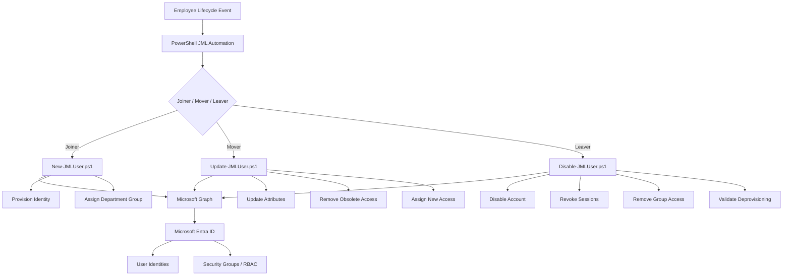

# Microsoft Entra ID Joiner-Mover-Leaver Identity Lifecycle Automation

PowerShell and Microsoft Graph automation that provisions, transitions and deprovisions Microsoft Entra ID identities, with departmental access expressed as security-group membership.


**Author:** Richard Oloja · [Portfolio case study](https://olojarichard.github.io/projects/entra-id-jml-identity-lifecycle/) · [LinkedIn](https://www.linkedin.com/in/olojarichard)

---

## Overview

Organizations must ensure that users receive the correct access throughout their employment lifecycle — and lose it promptly when it is no longer needed. This lab implements the three events that define that lifecycle:

| Event | Script | What it does |
|---|---|---|
| **Joiner** | [`scripts/joiner/New-JMLUser.ps1`](scripts/joiner/New-JMLUser.ps1) | Creates the Entra ID user, populates employee attributes, resolves the department to its RBAC group and assigns membership. |
| **Mover** | [`scripts/mover/Update-JMLUser.ps1`](scripts/mover/Update-JMLUser.ps1) | Updates department and job title, removes the previous departmental group and assigns the new one. |
| **Leaver** | [`scripts/leaver/Disable-JMLUser.ps1`](scripts/leaver/Disable-JMLUser.ps1) | Inventories group access, disables the account, revokes sign-in sessions, removes group memberships and validates the final state while retaining the identity for audit. |

Access is never granted to users directly. It flows from the `department` attribute to a corresponding Entra ID security group, so the directory itself expresses the access model and Mover/Leaver become tractable operations.

## Architecture



Further detail: [`docs/architecture.md`](docs/architecture.md).

## RBAC access model

| Department | Security group | Access model |
|---|---|---|
| Information Technology | `GRP-IT-Employees` | Baseline IT department access |
| Engineering | `GRP-Engineering-Employees` | Baseline Engineering department access |
| Finance | `GRP-Finance-Employees` | Baseline Finance department access |
| Human Resources | `GRP-HR-Employees` | Baseline HR department access |

The lab demonstrates group-membership management driven by department. It does not claim that each group has been bound to downstream application permissions. See [`docs/access-control-matrix.md`](docs/access-control-matrix.md).

## Prerequisites

- PowerShell 7+ (Windows PowerShell 5.1 also works)
- Microsoft Graph PowerShell SDK: `Install-Module Microsoft.Graph -Scope CurrentUser`
- The four security groups above created in the tenant
- A connection with the scopes the scripts use:

```powershell
Connect-MgGraph -Scopes "User.ReadWrite.All","Group.ReadWrite.All","GroupMember.ReadWrite.All","User.RevokeSessions.All"
```

For anything beyond a lab, use an app registration or managed identity with only these scopes rather than an interactive Global Administrator session.

## Usage

```powershell
# Joiner — provision a new employee
.\scripts\joiner\New-JMLUser.ps1 -FirstName Taylor -LastName Morgan `
    -Department Finance -JobTitle "Financial Analyst" `
    -EmployeeId EMP1002 -TenantDomain contoso.onmicrosoft.com

# Mover — transfer to another department
.\scripts\mover\Update-JMLUser.ps1 -UserPrincipalName taylor.morgan@contoso.onmicrosoft.com `
    -NewDepartment Engineering -NewJobTitle "Systems Engineer"

# Leaver — deprovision
.\scripts\leaver\Disable-JMLUser.ps1 -UserPrincipalName taylor.morgan@contoso.onmicrosoft.com
```

`Department` / `NewDepartment` are validated against the four supported values. All Graph calls run with `-ErrorAction Stop` inside `try/catch` and the scripts exit non-zero on failure, so a wrapping pipeline can detect a partial run.

## Validation

A full lifecycle test was run against a fictional lab identity, **Taylor Morgan (EMP1002)**:

| Stage | Transition | Documented result |
|---|---|---|
| Joiner | Finance · Financial Analyst · `GRP-Finance-Employees` · account enabled | **PASS** |
| Mover | Finance → Engineering · Financial Analyst → Systems Engineer · `GRP-Finance-Employees` removed · `GRP-Engineering-Employees` assigned | **PASS** |
| Leaver | `AccountEnabled = False` · remaining group memberships = 0 · identity retained · safe re-run on the deprovisioned identity | **PASS** |

These are documented lab results, not production test results. Details in [`docs/evidence/README.md`](docs/evidence/README.md).

## Security controls demonstrated

Identity lifecycle management · automated provisioning and deprovisioning · group-based authorization · role-based access control · least privilege · department-based access assignment · removal of obsolete access · account disabling · session revocation · post-change validation · audit-oriented identity retention.

## Known limitations

Stated plainly so the demonstrated capability is not overstated:

- **Mover** exits early when the department is unchanged, even if the requested job title differs; a title-only change is not applied.
- **Mover** is not transactional: if adding the new group fails after the old group has been removed, there is no automatic rollback.
- **Joiner** generates the temporary password with `Get-Random`, which is not a cryptographic random source. Acceptable for a lab; replace before production use.
- **Leaver** removes every object returned by `Get-MgUserMemberOf`. In tenants where that includes directory roles, dynamic groups, role-assignable groups or on-premises-synced groups, removal will fail for those objects. The workflow is validated for the assigned security-group model used in this lab.
- `Revoke-MgUserSignInSession` invalidates refresh tokens and session cookies; already-issued access tokens remain valid until they expire, so revocation is near-term rather than instantaneous.
- The scripts are operator-run; there is no HR-system trigger, approval step or logging sink.

## Security considerations

This repository intentionally excludes tenant IDs, object IDs used in testing, passwords, authentication tokens, client secrets and tenant-specific domains. All identities and employee information are fictional lab data.

## Repository structure

```text
entra-jml-identity-lifecycle/
├── README.md
├── scripts/
│   ├── joiner/   README.md · New-JMLUser.ps1
│   ├── mover/    README.md · Update-JMLUser.ps1
│   └── leaver/   README.md · Disable-JMLUser.ps1
└── docs/
    ├── architecture.md
    ├── access-control-matrix.md
    └── evidence/README.md
```
